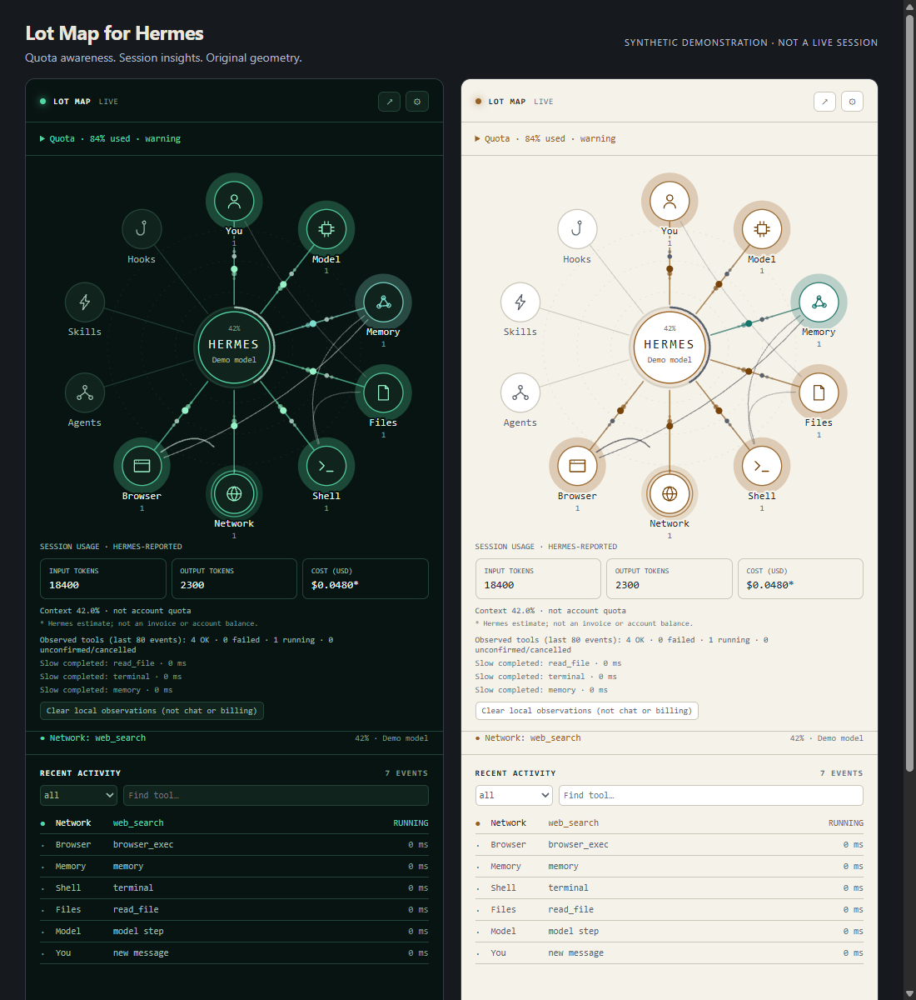

# Lot Map for Hermes

An independent community port of [alexeyw/lot-map](https://github.com/alexeyw/lot-map) to Hermes Agent. Original SVG and braille renderers; Hermes-native events. Not affiliated with or endorsed by Nous Research or the upstream author.



## Features
- Desktop side pane, full-page map, sidebar navigation and **Open Lot Map** command.
- Original circular stations, tool paths, motion, error markers and recent activity.
- Eight provider-aware palettes, centralized Settings and reduced-motion support.
- Optional original braille TUI widget, with a passive profile-local event observer.

## Themes, Settings and terminal UI
- Eight palettes: Obsidian, Paper, Emerald, Ember, Azure, Violet, Rose, Midnight. New installations use **Auto/provider**: OpenAI/Codex → Emerald, Anthropic → Ember, Gemini → Azure, Nous → Violet, OpenRouter → Rose, DeepSeek → Midnight. Unknown provider → Obsidian. Provider comes from the exact session's Hermes metadata, never guessed from its model name.
- Click **⚙ Settings** to choose manual theme, override the current provider mapping, set motion/density, hide usage/activity, or configure cached quota and thresholds. Settings sync between Lot Map views in this window. Legacy explicit light/dark preferences migrate to manual Paper/Obsidian; reset returns to Auto/provider. This never changes Hermes' global theme.
- Quota is now a **collapsed summary chip below the header**; click it for details/refresh. Multiple cached accounts show an overview/highest reported usage, not an assertion that the account is currently active. Stale and unknown remain explicit.
- Stable SVG markup is reused on clock/quota updates instead of restarting motion each second. Actual activity/theme changes still redraw the map. Hidden tabs/panes stop animation and periodic view refresh. Auto follows reduced-motion preference; reduced/off suppress transitions.
- `/lot-map` is a compact four-row ambient TUI card by default; it does not capture typing. `/lot-map-settings` opens a modal: ↑/↓ selects a field, ←/→ changes it, Esc/q closes. Choose compact/map, theme, motion and density. Map requires enough terminal space; narrower terminals keep compact output. Settings are profile-local at `lot-map/tui-settings.json`; TUI Auto uses the Hermes skin because the widget SDK has no provider metadata. `NO_COLOR` disables widget color.
- Classic CLI snapshot (not an interactive widget): `python scripts/status.py --home /path/to/hermes`; add `--json` for structured output. It reads only bounded local activity metadata, not prompts or credentials, and does not infer quota. See `docs/cli-preview.txt` for synthetic output.

## UI customization
Open **Settings** to control individual sections and elements. The Settings button always stays available, even when every content section is hidden.

- Sections: map, quota, session insights, current activity strip, activity feed.
- Header: title, live badge, expand/back button.
- Insights: input/output tokens, estimated cost, context, tool counters, slow tools, clear-observations action.
- Feed: heading/count, search/filters, status icons, station column, duration/state column, and visible row limit (3–80).
- Quota: remaining bar, icons, reset clock and countdown independently. When cache integration is enabled, **Settings → Quota providers** lets you show/hide cached provider entries individually, with Show all / Hide all. The same selection applies to the summary and cards; hidden providers remain collected by the separate quota plugin. Choose **Show providers → custom** to use an explicit selection: only checked providers appear, and new providers stay hidden. **all** preserves the overview. Hiding quota unmounts its component and stops its queries.
- Appearance: 8 palettes, provider mappings, motion, compact/comfortable density, monospace/system fonts, text size (10–18px), map width (240–900px), corner radius (0–20px).
- Quick layout presets: **Minimal**, **Balanced**, **Focus**. These only change section visibility; they do not change quota data permissions or your theme. Reset returns to safe defaults, including quota-cache opt-out.

All plugin-authored interface labels, tooltips and states are English. Provider-supplied account-limit text is displayed as returned by Hermes, not translated or reinterpreted.

## Practical monitoring (0.2.0)
- **Account quota**: native `session.account_usage` for the focused session's exact connection/profile; unmodified provider limit text, received time, manual refresh and five-minute refresh while visible. Unknown/unsupported/denied responses never become zero quota.
- **Optional structured quota**: enable the installed `quota` plugin cache integration. Reads `quota status --json --cached` through Hermes `cli.exec` for that exact profile every 60 seconds while visible. It does not install the plugin or run provider refresh. Shows used/remaining percentage, reported resets, cache age and configurable 80%/95% warnings. Cache older than 30 minutes or a passed reset is unconfirmed, not an assurance of availability. Cached profiles may include multiple accounts; they are not assumed to be the active model account.
- **Session usage**: Hermes-reported input/output token totals, estimated cost (not an invoice), separate context-pressure warning. No billing rates are guessed.
- **Tool diagnostics**: completed/failed/unconfirmed counts, slowest completed tools and a warning for tools running 30 seconds or longer (not proof of a hang). Missing completion on turn end is unconfirmed, not success. The 80-event window is not all-time analytics.
- Filter errors/unknown or running events, search tool names, and clear local observations without deleting chat or billing. Alerts remain inside Lot Map; no OS notifications, auto-retries, task interruption or automatic provider/model switching.
- TUI adds recent completion/failure and long/unmatched-start counters. It deliberately does not claim account quota without a trusted TUI source.

## Status and requirements
Community preview **0.2.0**. The catalog submission may still pin 0.1.0. Requires Hermes **0.23.3 or later** with the Desktop Plugin SDK; the optional widget requires the Ink TUI widget SDK. Python runtime uses only the standard library. No npm install or build step for users.

The original upstream plugin targets Claude Code. This port does **not** reproduce Claude hooks, all upstream options, per-station token accounting or terminal image protocols. Desktop starts collecting on load and follows the focused runtime session. TUI shows the latest session in its profile's local event file, not necessarily the focused Desktop chat. A tool blocked before execution may show an unmatched start if Hermes does not emit completion.

## Install
This project is **not listed in the Hermes catalog yet**. Install from the public community repository:

```sh
hermes plugins install thanhduy1706/lot-map-hermes --enable
```

Review the source and scanner disclosures before confirming installation. For reproducible installations, use `--ref` with the reviewed full commit SHA. In Desktop, enable **Lot Map for Hermes** under **Capabilities → Plugins** as well (the packaged Desktop surface is opt-in). Do not install a second standalone Desktop copy of the same plugin ID. Existing local prototypes must be backed up and removed deliberately before migration; this project never replaces them automatically.

### Optional TUI widget
From the installed plugin directory:

```sh
python scripts/install-tui.py
```

Set `HERMES_HOME` or pass `--home /path/to/profile` to target a named profile. Restart the TUI after copying; open/toggle using `/lot-map`. Existing different widgets are refused by default; `--force` creates a content-addressed backup first. Rerun after updating the package to refresh this separately copied widget.

### Uninstall
From the plugin checkout, remove the widget **before** removing the package:

```sh
python scripts/install-tui.py --remove
hermes plugins remove lot-map
```

The widget remover refuses to delete files without this package's ownership marker. Runtime event data under `<HERMES_HOME>/lot-map/` is retained; remove that directory manually if no longer wanted. Disable the agent plugin to stop new event recording; disable its Desktop surface to stop the view.

## Privacy and behavior disclosure
- No telemetry, direct provider requests, credential access or self-updater. Native account-limit requests may cause **Hermes** to contact the provider using its own approved credential flow. Optional cached quota uses the public `cli.exec` RPC to run the fixed Hermes quota read command; no arbitrary shell or refresh command is constructed. These additions change the no-network/no-subprocess disclosure of 0.1.0.
- Desktop subscribes only through the public SDK; transient tool names/timing/status and runtime session IDs stay in renderer memory (up to 24 sessions, 80 recent rows each). It displays the host's current model and context percentage when available. Theme, quota-cache opt-in and warning thresholds are stored in plugin-scoped storage. Quota responses stay in a connection/profile/session-keyed React Query memory cache (no persistent quota snapshots); unload cancels/removes plugin queries. Account limit text may include provider account labels; do not share screenshots without checking them.
- The Python observer receives hook arguments/results from Hermes, but never persists their contents. It inspects structural result markers for failures; arguments are ignored.
- TUI appearance settings are stored in `<HERMES_HOME>/lot-map/tui-settings.json`; no credentials are written. TUI metadata is stored at `<HERMES_HOME>/lot-map/events.jsonl`: timestamp, tool name, lifecycle kind, failure flag, and truncated SHA-256 session/call identifiers. Hashes are correlation IDs, **not** a guarantee of anonymity. Rotation keeps approximately 512 KB (it can exceed that by one row). Retention is size-based, not age-based.
- The TUI reads only that file, polling once a second. No prompts, commands, file paths, URLs, raw tool arguments/results or credentials are intentionally stored. Tool names themselves can reveal which integrations you use. Do not share your event file.
- The explicit widget installer writes to `tui-widgets/` in the selected profile. `--force` also writes a backup beside the widget. No installer changes core code or configuration directly.
- Observer I/O failures are ignored so visualization does not change tool arguments, results or approvals. File rotation is thread-safe within one process; multiple independent gateways sharing a profile are not a supported configuration.

## Development and verification
```sh
python scripts/build.py
node --check desktop/plugin.js
node --check tui/lot-map.mjs
node tests/smoke.mjs
node tests/quota.mjs
node tests/quota-reset.mjs
node tests/quota-glance.mjs
node tests/quota-providers.mjs
node tests/customize.mjs
node tests/quota-view.mjs
node tests/insights.mjs
node tests/themes.mjs
node tests/settings.mjs
node tests/motion.mjs
node tests/ui-state.mjs
node tests/tui-layout.mjs
python -m unittest discover -s tests -p 'test_*.py'
hermes plugins validate . --install-deps
```
The build is offline and combines readable renderer bundles with adapters. See [NOTICE.md](NOTICE.md) for source provenance and renderer regeneration. Tests use synthetic events, temporary profile directories and mocked SDKs; they are not a claim of live cross-platform UI certification. The README image is generated from synthetic data and explicitly labelled.

## License
MIT. Upstream copyright and license retained in [LICENSE.upstream](LICENSE.upstream); attribution and pinned source in [NOTICE.md](NOTICE.md).
